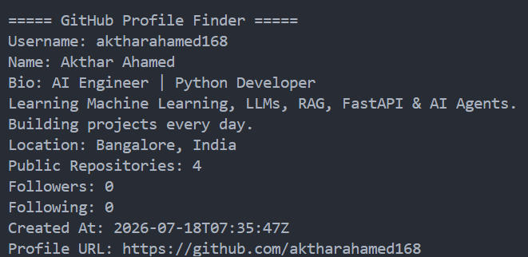

 <div align="center">

# GitHub Profile Finder

Retrieve and display public GitHub user profile information using the GitHub REST API and Python.


</div>

---

## About

GitHub Profile Finder is a Python command-line application that retrieves public GitHub profile information using the GitHub REST API.

Users can enter a GitHub username to view profile details such as repositories, followers, following, bio, and profile URL.

---

## Features

- Search GitHub users by username
- Retrieve public profile information
- Display repository count
- Display followers and following
- Show profile creation date
- Handle invalid usernames
- Handle API errors and connection issues

---

## How It Works

```text
Enter GitHub Username
          ↓
    Python Program
          ↓
    GitHub REST API
          ↓
      GET Request
          ↓
     JSON Response
          ↓
   Extract Profile Data
          ↓
    Display Results
```

---

## Tech Stack

| Technology | Purpose |
|------------|---------|
| Python | Programming Language |
| Requests | HTTP Requests |
| GitHub REST API | Retrieve Profile Data |
| JSON | API Response Handling |

---

## Project Structure

```text
29-github-profile-finder/
│
├── main.py
├── requirements.txt
├── README.md
└── screenshot.png
```

---

## Installation

Clone the repository or download the project.

Install the required library:

```bash
pip install -r requirements.txt
```

---

## Usage

Run the program:

```bash
python main.py
```

Enter a GitHub username:

```text
===== GitHub Profile Finder =====

Enter GitHub username: octocat
```

---

## Sample Output

```text
===== GitHub Profile Finder =====

Username: octocat
Name: The Octocat
Bio: Not available
Location: Not available
Public Repositories: 8
Followers: 10000
Following: 9
Created At: 2011-01-25T18:44:36Z
Profile URL: https://github.com/octocat
```

*Note: Profile information and counts can change. The output above is illustrative.*

---

## Error Handling

| Status | Description |
|--------|-------------|
| 200 | Profile found successfully |
| 403 | API rate limit or access restriction |
| 404 | GitHub user not found |
| Timeout | Request timed out |
| Connection Error | Internet connection problem |

---

## Screenshot

<p align="center">
  
</p>

---

## Future Improvements

- Display top repositories
- Show most-used programming languages
- Add repository search
- Create a graphical user interface
- Display GitHub contribution statistics
- Compare multiple GitHub profiles

---

## Author

**Akthar Ahamed**

GitHub: https://github.com/aktharahamed168

LinkedIn: https://www.linkedin.com/in/akthar-ahamed/
